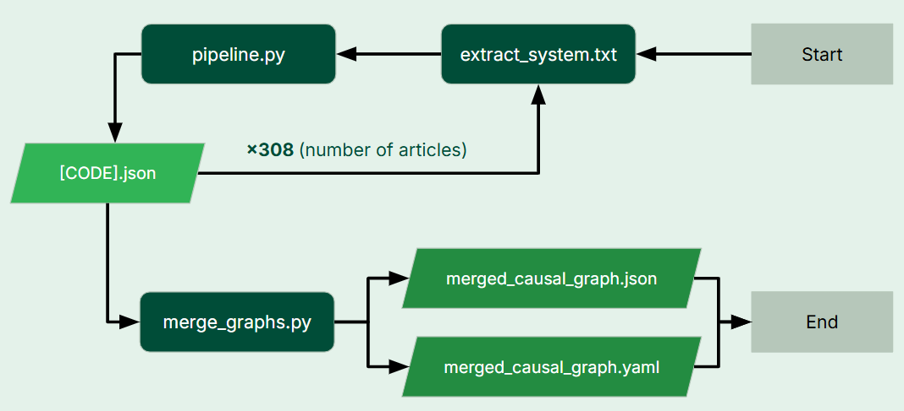

# Evidence Jam 2026 — Team d (Lane 1: Causal Annotation) 

## Our challenge

> **Create a script that annotates the scientific journal articles, contained in**
> **`corpus/` in markdown format, using the Causal Mosaic Schema (CAMO). The annotations**
> **should be in YAML and JSON. Use ontologies where-ever possible.**

We were tasked with creating a script that reads the articles in `corpus/` and produces one merged CAMO graph, in both YAML and JSON. The graph should be valid under `schema/causalmosaic.yaml`, displaying causal claims, their topics, strengths, and locations in the original text.

## What's in this repo

```
corpus/              308 ecological restoration articles, one markdown file each
corpus/index.csv     Data on slug, DOI, title, authors, year, journal, word count
example/             Hand-checked CAMO annotation of one article
out/                 WHAT IS THIS FOLDER FOR?
prompts/             Written prompt for Qwen to understand the project
schema/              The Causal Mosaic Schema (CAMO) v0.10.0, as LinkML
src/                 Source code for extraction pipeline and creation of merged graph
BACKGROUND.md        Original project README
run.sh               File to organize entire process into one command
```

### `corpus/`

Each article is named by a short slug (e.g. `YKQQZV93.md`) and was converted
from PDF, so conversion artefacts were expected: image placeholders, broken tables,
headers and footers mid-paragraph, and inline tags. Use
`corpus/index.csv` to look up an article's DOI and bibliographic details.

### `example/`

Worked annotation showing what good output looks like: `Murphy2005.yaml`
and its source: `Murphy2005.pdf`

### `schema/causalmosaic.yaml`

The Causal Mosaic Schema is a way of describing causal relationships between 
populations of taxa, environmental variables, composite variables, management
interventions and environmental processes. The header comments and
the `description` on every class, slot, and enum are the annotation guide.

### `src/`

The source code in this repo includes: 
- `pipeline.py`: Our extraction pipeline, which builds Causal Mosaic Schema files for each article. Our final version uses a whitelist to select important parts of articles and runs workers asynchronously to decrease endpoint timeouts.
- `pipeline_original.py`: The original pipeline iteration. This version uses a blacklist to skip less useful parts of articles and runs workers in sync.
- `merge_graphs.py`: Program to merge single article outputs into final YAML/JSON schema.

An annotation essentials guide can be found at [this link](https://tim-a.ca/causalmosaic/camo_annotation_essentials.html). 

## Our Solution

Our solution to Lane 1 involves a simple data extraction pipeline, shown below.



Using the prompt from `extract_system.txt`, `pipeline.py` runs for each article: pulling relevant sentences from the text, drawing insights into the CAMO schema, and creating [ARTICLE CODE].json. After creating all the single article outputs, merge_graphs.py runs, merging all the JSON files into a completed causal graph in both JSON and YAML formats.

### How pipeline.py works

Description of how pipeline.py works

## How merge_graphs.py works

Description of how merge_graphs.py works

## Running the Program

Description of how to run the program using run.sh